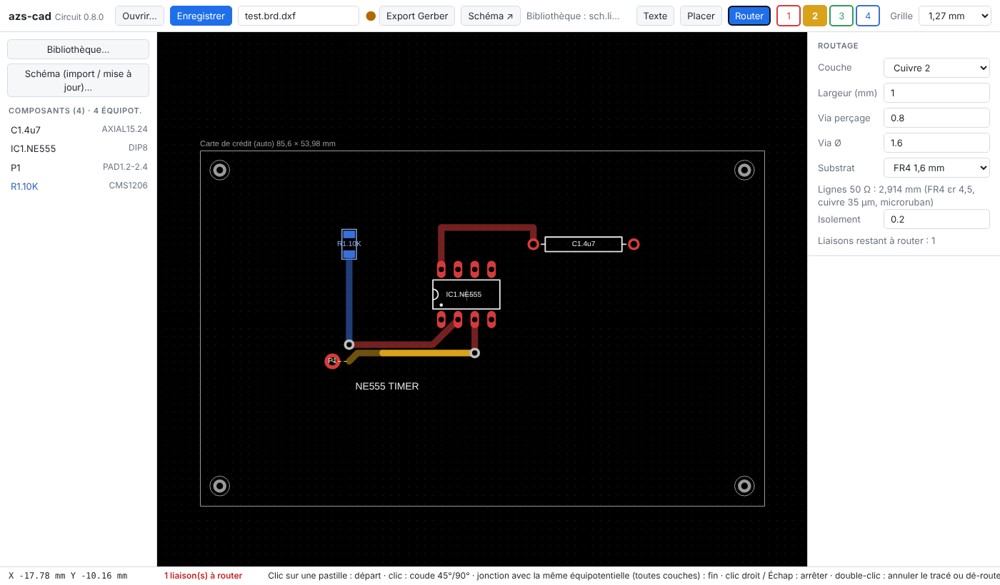
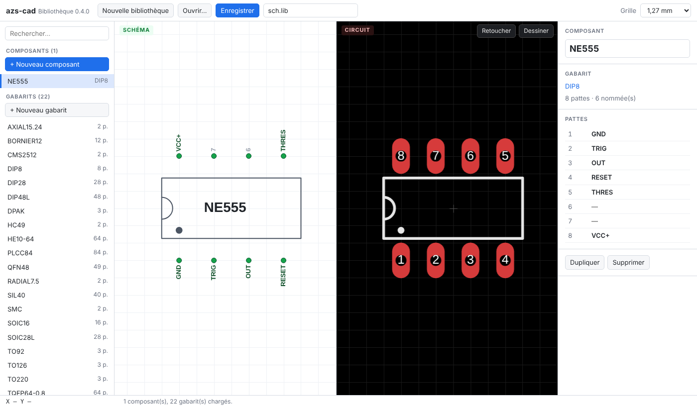
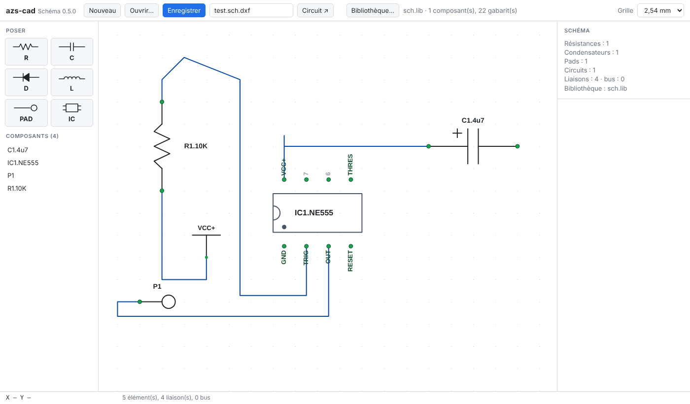
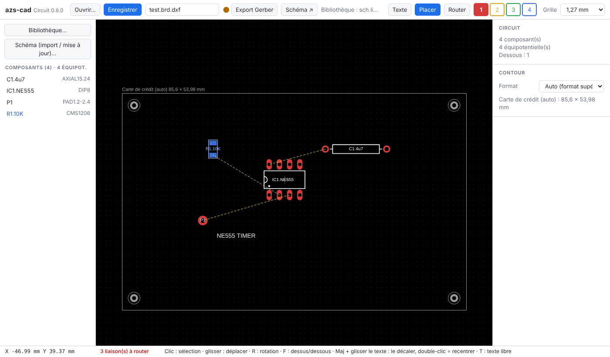
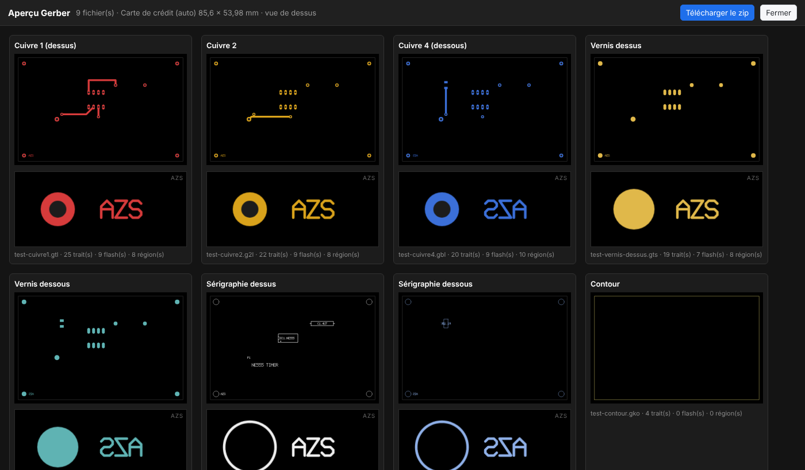

# azs-cad — CAO de circuits imprimés dans le navigateur

**🇫🇷 Français** · [🇬🇧 English](README.md)

Bibliothèque de composants, saisie de schéma et circuit imprimé multicouche, en trois pages HTML autonomes : HTML/CSS/JavaScript natif, aucune dépendance, fonctionne hors ligne. Esprit Eagle 4.01, sans en être un clone : routage manuel, 4 couches de cuivre, export Gerber RS-274X et Excellon.

L'interface s'affiche en français si le navigateur est en français, en anglais sinon.



## Fichiers

| Fichier | Version | Rôle |
|---|---|---|
| `bibliotheque.html` | 0.4.0 | Bibliothèque : composants, gabarits, nom des pattes |
| `schema.html` | 0.5.0 | Saisie de schéma |
| `board.html` | 0.8.0 | Circuit imprimé : placement, routage, export |
| `LISEZMOI.md`, `README.md` | | Documentation en français, en anglais |
| `LICENSE` | | CC BY-NC 4.0 |

Les trois pages doivent être dans le **même dossier** et ouvertes dans le **même navigateur** (Chrome ou Edge conseillés).

## Démarrage

1. Ouvrir `bibliotheque.html`, créer ou ouvrir une bibliothèque `.lib`, l'enregistrer.
2. Ouvrir `schema.html`, charger la bibliothèque, saisir le schéma.
3. Bouton **Circuit ↗** : `board.html` s'ouvre sur le même projet et suit le schéma en direct, sans enregistrement ni rechargement.
4. Placer, router, choisir le contour, puis **Export Gerber** : aperçu, et téléchargement d'un zip.

## Bibliothèque — `bibliotheque.html`



- Double vue : **SCHÉMA** (fond blanc, pattes vertes) et **CIRCUIT** (fond noir, cuivre rouge), zoom et déplacement partagés.
- **+ Nouveau composant** : famille normalisée et nombre de pattes, puis nom (ex. `NE555`). Familles : DIP étroit/large, SIL, HE10, bornier, axial, radial, TO-92/126/220, HC-49, SOIC, TSSOP, PLCC, TQFP, QFN, CMS 0402 à 2512, diodes CMS, SOT, DPAK.
- Nom des pattes : clic sur la patte (Tab = patte suivante), clic droit = liste (VCC+, GND…), ou tableau Patte | Nom.
- **Retoucher** : sélection, poignées, déplacement, rotation (R), suppression (Suppr), type DIL/CMS changé sur place. **Dessiner** : pads DIL/CMS, trait, rectangle, arc, cercle, point, texte.
- Le vernis n'est pas dessiné : il découle des pastilles.

Format `.lib` (texte, mm, degrés, une instruction par ligne, `#` = commentaire) :

```
PACKAGE DIP8
PAD 1 -3.81 -3.81 0.8 1.3 OVALE 90      # nom x y perçage diamètre ROND|CARRE|OVALE rotation
SMD 1 -0.95 0 0.6 1.0 0                  # nom x y dx dy rotation
TRAIT x1 y1 x2 y2 épaisseur
RECT x1 y1 x2 y2 épaisseur
ARC cx cy r angle1 angle2 épaisseur      # sens trigonométrique
CERCLE cx cy r épaisseur
POINT x y r
FIN
COMPOSANT NE555 DIP8 SOIC8               # nom puis gabarits possibles
GND => 1
VCC+ => 8
FIN
```

## Schéma — `schema.html`



- Palette : **R** (zigzag), **C** (deux plaques, polarisé « + » au-delà de 1 µF, forçable), **D** (patte 1 = cathode), **L**, **PAD** (une patte), **IC** (dessiné comme dans la bibliothèque). Repères automatiques R1, C1, D1, L1, P1, IC1 ; libellés `IC1.NE555`, `R1.10K`.
- Clic dans le vide : repose le dernier composant, même valeur.
- Liaison : clic patte → patte. Clic droit sur une patte : **VCC+** ou **GND**.
- Groupes : Ctrl+clic / Maj+clic sur des pattes ; deux groupes de même taille forment un **bus** (peignes et tronc gras marqué du nombre), appairé par numéro de patte.
- Fil sélectionné : carré = déplacer un coude, rond au milieu = nouveau coude, double-clic = effacer. Type **Électrique** ou **Ligne 50 Ω** (orange pointillé). Tracé automatique orthogonal.
- Croisement de deux équipotentielles : encoche ; même équipotentielle : point.
- R : rotation · Suppr : supprimer · Ctrl+Z / Ctrl+Y · Ctrl+S.

## Circuit — `board.html`



### Placement
- Import du schéma, ou lien **Schéma ↗ / Circuit ↗** : composants pré-placés selon le schéma, écartés juste assez pour ne pas se chevaucher.
- Gabarit choisi dans la fiche : ceux de la bibliothèque, puis les **normalisés** générés (mêmes familles que la bibliothèque, pastille seule traversante ou CMS). Les passifs reprennent le dernier gabarit choisi pour leur type.
- R : rotation · F : dessus / dessous (le dessous s'affiche en bleu, vu de dessus).
- Le texte `IC1.NE555` est collé au composant ; Maj + glisser le décale, double-clic le recentre.
- **Texte** (T) : texte libre de sérigraphie, hauteur en mm, face au choix.
- Un composant déplacé, tourné, retourné ou changé de gabarit perd son cuivre : ses liaisons repartent en chevelu.

### Routage
- **Router**, puis clic sur une pastille : départ sur la couche de la face du composant (cuivre 1 dessus, cuivre 4 dessous).
- Chaque clic pose un coude droit puis à 45°. Touches **1 à 4** ou boutons colorés : changement de couche, via posée automatiquement.
- Fin : clic sur une pastille, une piste ou une via de la même équipotentielle, sur n'importe quelle couche (via posée d'office si besoin). Clic droit ou Échap : arrêt en gardant les segments. **Double-clic : annule le tracé en cours.**
- Hors tracé : double-clic sur une piste ou une via = dé-routage, retour au chevelu jaune pointillé.
- Clic sur un segment : sélection ; glisser = déplacer ; Suppr = supprimer ; clic sur l'extrémité libre d'un segment sélectionné = prolonger. Clic droit sur une piste : largeur standard (0,2 à 2,54 mm) ou saisie.
- Le chevelu jaune pointillé suit le tracé ; les lignes 50 Ω sont en orange.
- Isolement : un passage trop près du cuivre d'une autre équipotentielle est entouré d'un cercle mauve avec la distance mesurée ; la pose n'est jamais refusée.
- Compteur permanent des liaisons restant à router dans la barre d'état.

### Réglages de fabrication

| Réglage | Défaut | Minimum (PCBCart standard × 2) |
|---|---|---|
| Largeur de piste | 1 mm, puis la dernière utilisée | 0,152 mm |
| Isolement | 0,2 mm | 0,152 mm |
| Via (perçage / Ø) | 0,8 / 1,6 mm | perçage 0,304 mm, couronne 0,152 mm |
| Substrat | FR4 1,6 mm (ou 0,8), εr 4,5, cuivre 35 µm | |

Largeur 50 Ω (microruban, IPC-2141) : `w = (5,98·h / exp(50·√(εr+1,41) / 87) − t) / 0,8`, soit 2,914 mm sur 1,6 mm.

### Contour et export



- Contour : **Auto** (carte de crédit 85,6 × 54, sinon Europe 160 × 100, sinon taille juste au-dessus), format imposé ou **Personnalisé** ; 5 mm de marge, centré sur le projet.
- 4 mires d'alignement à 3 mm des coins (cuivre Ø 2, vernis Ø 2,4, sérigraphie Ø 3, trou Ø 1) et « **AZS** » sur toutes les couches pour contrôler le sens : lisible dessus, en miroir dessous.
- **Export Gerber** : aperçu relu depuis les fichiers produits — miniatures vues de dessus, loupe sur « AZS », vue agrandie avec couches superposables, transparence, coordonnées et mesure (Maj + clic) — puis **Télécharger le zip** `<nom>-gerber.zip`.


| Fichier | Contenu |
|---|---|
| `-cuivre1.gtl` | Cuivre 1 (dessus) |
| `-cuivre2.g2l`, `-cuivre3.g3l` | Cuivres internes, s'ils portent une piste |
| `-cuivre4.gbl` | Cuivre 4 (dessous) |
| `-vernis-dessus.gts`, `-vernis-dessous.gbs` | Ouvertures de vernis (marge 0,1 mm) |
| `-serigraphie-dessus.gto`, `-serigraphie-dessous.gbo` | Sérigraphie (police au trait, majuscules) |
| `-contour.gko` | Contour |
| `-percage.drl` | Perçage Excellon (mm) |

## Lien schéma ↔ circuit

Chaque page publie son état à chaque changement dans le stockage local du navigateur ; l'autre page le suit sans action. Ce qui n'a pas changé reste en place et routé ; un composant ajouté arrive à droite de la carte ; un composant supprimé part avec son cuivre ; une liaison modifiée fait sauter les pistes de son équipotentielle. **Enregistrer** produit les fichiers sur disque.

## Raccourcis

| Touche | Bibliothèque | Schéma | Circuit |
|---|---|---|---|
| R | rotation | rotation | rotation |
| F | | | dessus / dessous |
| T | | | texte libre |
| 1 à 4 | | | couche de cuivre (via en cours de tracé) |
| Suppr | supprimer | supprimer | segment, via ou texte |
| Échap | fin d'action | annuler la pose / la liaison | arrêter le tracé, désélectionner |
| Ctrl+Z / Ctrl+Y | annuler / rétablir | annuler / rétablir | annuler / rétablir |
| Ctrl+S | enregistrer | enregistrer | enregistrer |

## Formats

- Schéma `.sch.dxf` et circuit `.brd.dxf` : **AutoCAD R12 (AC1009)** multicalque, lisibles par tout logiciel de DAO ; données azs-cad en XDATA (APPID `AZSCAD` ; les fichiers `AIGLECAD` des premières versions restent lus).
- Calques du circuit : `CUIVRE_1` à `CUIVRE_4`, `VERNIS_DESSUS`, `VERNIS_DESSOUS`, `TEXTE_DESSUS`, `TEXTE_DESSOUS`, `PERCAGE`, `CHEVELU`, `AZSCAD`.
- Bibliothèque `.lib` : texte (voir plus haut).

## Limites

Pas d'autoroutage, pas de plans de masse, vias traversantes uniquement, pas de couche restrict/keepout. Le lien schéma ↔ circuit exige le même navigateur.

## Licence

Libre pour un usage non commercial, sous licence [CC BY-NC 4.0](https://creativecommons.org/licenses/by-nc/4.0/deed.fr), avec mention obligatoire de la source et de l'auteur : « azs-cad — Eric PERRET — https://github.com/ericperret/azs-cad ». Toute utilisation commerciale est interdite sans l'autorisation écrite de l'auteur, à demander par courriel : eperret@azs.fr. Voir `LICENSE`.

## Auteur

© Eric PERRET 2026 · eperret@azs.fr · www.azs.fr
