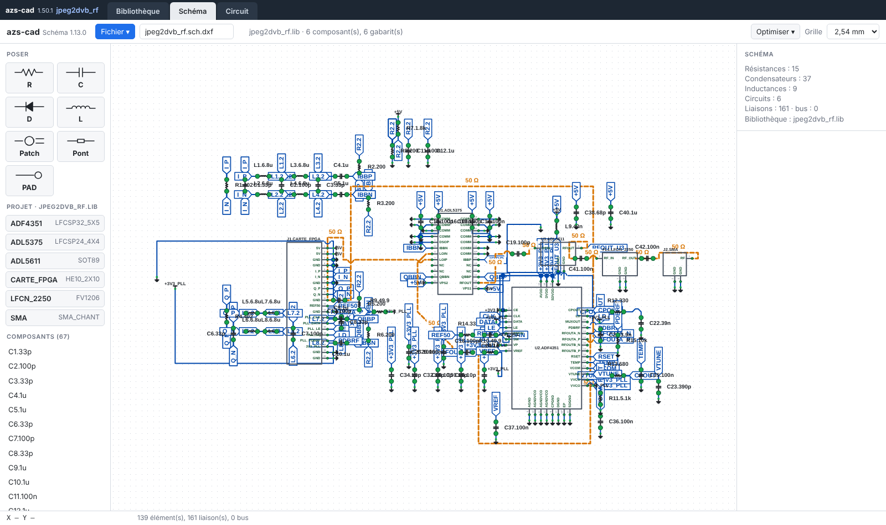
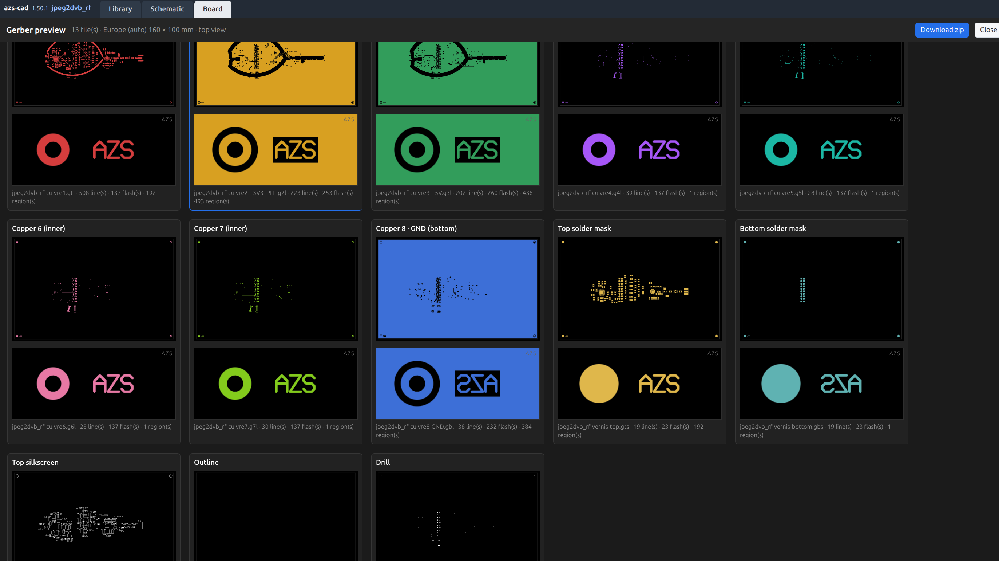

# azs-cad

Une CAO de circuits imprimés qui tourne dans un navigateur : **une seule page HTML, `azs-cad.html`**, en HTML, CSS et JavaScript natifs, sans librairie ni dépendance, utilisable hors ligne. Dans l'esprit d'Eagle 4.01 (bibliothèque, schéma, circuit), sans en être un clone. L'interface est en français ou en anglais selon le navigateur. Version actuelle : **1.73.1**.

## Modules

Un seul projet est ouvert à la fois, partagé en mémoire par les trois modules (rien n'est stocké dans le navigateur).

- **Bibliothèque** : gabarits THT et CMS courants, noms de pattes, gabarits normalisés IPC-7351 (SSOP, TSSOP, MSOP, TQFP jusqu'à 208 pattes, QFN jusqu'à 64 pattes, DFN/SON, BGA, FBGA, uBGA/CSP, WLCSP, SOT, D2PAK, quartz, CMS 0201 à 1812, tantale A à D ; `internal.lib` les charge tous), import de gabarits fabricants (`.zip` ou `.lbr`).
- **Schéma** : passifs, circuits intégrés (symbole logique), connecteurs, bus (Ctrl+clic sur plusieurs fils ▸ Bus, nom modifiable, bus entre planches), alimentations (clic droit sur une patte : masses, tensions courantes ou nom libre), lignes 50 Ω, choix de la fonction des pattes multifonction. Grille automatique et invisible, au pas des pattes du composant le plus fin : à la pose, au déplacement et à la rotation, la patte 1 tombe sur la grille. Édition fluide même sur un grand schéma (un dessin par image, seul le visible est dessiné, fils provisoires pendant un glisser). Optimiser : placement, fils à 45°, fils espacés, étiquettes d'équipotentielle à la place des fils trop longs, rangement des alimentations, **revue des découplages**.
- **Circuit** : 2 à 8 couches, plans de masse et d'alimentation, routage manuel à 45°, vias automatiques, via dans la pastille des boîtiers à billes, contrôle des espacements, sérigraphie, optimisation et routage automatique.

## Circuit

- **Empilage** : une masse unique au dessous, un plan par alimentation secondaire (tensions identiques regroupées sur une même couche), signaux partout. Panneau *Plans d'alimentation* : réseau par réseau, auto / sans plan / couche interne choisie.
- **Minimums de fabrication** PCBCart + 33 % ; seuls la largeur de piste et le perçage des vias se règlent, le Ø de cuivre en découle.
- **Router le chevelu** : routage automatique par priorité (lignes 50 Ω, signaux, alimentations, masses), en spirale horaire depuis l'IC le plus dense, passe dessus puis dessous. Une équipotentielle qui a un plan n'est jamais tracée en pistes : ses pattes rejoignent le plan par leur via.
- **Re-router**, trois modes (hors lignes 50 Ω, patchs, plans et faces remplies), progression en jaune, Échap pour arrêter, un seul Ctrl+Z :
  - *au plus court* : chaque piste est défaite puis refaite ; le nouveau tracé n'est gardé que si son coût (longueur + vias) ne monte pas, ou s'il passe moins souvent entre les pattes d'un composant fin ; patte par patte, tronçon par tronçon, pas à pas (Espace, flèches, Échap), décision et raison affichées. Un **contrôle d'isolement** termine : piste ou via trop près du cuivre voisin ou du bord, ou posée entre deux pattes, son cuivre repart en chevelu ;
  - *quoi qu'il en coûte* : chaque équipotentielle est défaite et retracée, alimentations en pistes d'abord puis des plus courtes aux plus longues, gardée même plus longue ; bilan longueur et vias avant / après ;
  - *par négociation* (méthode PathFinder) : les équipotentielles se disputent la place à un coût de congestion qui monte à chaque itération ; l'ordre ne décide plus ; résultat gardé seulement sans conflit, connexité intacte et coût total plus bas, puis affiné équipotentielle par équipotentielle.
- **Modèle de coût du routeur** : aucune pénalité de couche en profondeur ; seule une couche de plan traversée reste chère ; une via compte comme un changement de couche (1,5 mm par défaut) ; via d'une patte CMS au centre exact de sa pastille, jamais collée à côté ; pastille trop fine pour une via : la via s'éloigne dans l'axe ; via entre les pastilles d'un même composant ou trop près d'une pastille étrangère pénalisée.
- **Vias** : une via déjà dans la pastille est reprise ; doublons et remontées inutiles (piste courte entre deux vias, même couche de part et d'autre) supprimés par Optimiser ▸ Vias et en fin de re-routage.
- **Composants fins** (pas de 1,27 mm ou moins, SOIC compris) : ni piste ni via entre deux pattes voisines ; deux vias et passage dessous ou à côté sont préférés.
- **Pondérations du routage** (Optimiser) : distance, couche d'alimentation, via (mm par changement de couche), passage sous une ligne 50 Ω, dessin dans une couche d'alimentation, passage entre pattes fines ; enregistrées dans le circuit.
- **Grille et maille** : grille du circuit toujours automatique (pas le plus fin des IC) ; maille du tracé indépendante, divisant le pas des billes (via dans chaque bille) ; sous un boîtier à billes, les couches internes gardent leurs ponts de cuivre entre vias.
- **Sélection de groupe** : Ctrl + rectangle(s), relâcher Ctrl : composants, pistes, vias et textes de la zone suivent la souris, clic pour poser ; pistes coupées par le bord de la zone remises en chevelu.
- **Optimiser** : vias, coudes à 45°, pistes qui se longent espacées, pistes centrées entre voisines (une via suit la piste, ou son attaque est décalée à 45°), LED, résistances et condensateurs de liaison rapprochés de leurs pattes.
- **Clic droit sur une piste** : largeur, centrage, **Arrondir** (un seul arc ; sur une pastille de circuit intégré, sortie droite dans l'axe puis l'arc).
- **Contour** : format au choix, marge, coins droits, convexes ou concaves ; *Recentrer* donne des marges égales haut / bas et gauche / droite.
- **Couches** : *Vider* une couche interne re-route ses équipotentielles ailleurs et liste ce qui reste.
- **Pont d'irrigation** : un plan d'alimentation coupé en îlots est ré-alimenté par une ligne de 1 mm × 5 mm sur les couches internes de signal, quatre vias façon DIL et une sérigraphie (IRRIGATION réseau).
- **Découplages** : la *Revue* propose, par patte d'alimentation d'IC, un 100 nF et un condensateur de réservoir, et supprime les redondants (appliqué aussi au schéma). *Placer* pose chaque condensateur dans la place libre la plus proche de la patte servie, en spirale.

## RF 50 Ω

- La largeur de ligne suit l'épaisseur du substrat.
- Clic droit sur une ligne 50 Ω : longueur, **Arrondir** (un seul arc sur toute la ligne pleine largeur) ; ligne de moins de 1 cm : largeur 50 Ω proposée en tête.
- Le routeur ne laisse passer un autre signal sous une ligne 50 Ω épaisse qu'en dernier recours : couche interne, à 90°, droit, longueur fixe, compté dans le bilan.
- Motifs de 400 à 3000 MHz : diviseur Wilkinson 2 voies, diviseur en T 2/4/8 sorties, coupleur directionnel 15/20/30 dB, filtres passe-bas et passe-bande, antenne patch rectangulaire, monopôle λ/4.

## Sorties

- Gerber RS-274X et Excellon dans une archive avec aperçu (zones non irriguées visibles). L'export est refusé tant qu'un texte de sérigraphie est sur une pastille.
- Nomenclature `.xls` et `.csv` aux colonnes de la BOM de référence.
- Projet : `<projet>.azs.zip` contenant `<projet>.lib`, `<projet>.sch.dxf` et `<projet>.brd.dxf` (DXF R12). Ctrl+S l'enregistre. Le circuit n'est jamais modifié tout seul : « Mettre à jour le circuit » est proposé quand le schéma diffère.

## Utilisation

1. Onglet Bibliothèque : créer un projet, ouvrir une bibliothèque de gabarits, cocher les composants.
2. Onglet Schéma : poser, câbler, optimiser.
3. Onglet Circuit : mettre à jour depuis le schéma, router, optimiser, exporter.

Ouvrir un projet existant : choisir son `.azs.zip` (ancien projet : `.lib` avec ses `.sch.dxf` et `.brd.dxf`).

Exemple d'optimisation du circuit sur `tvp5150_essai` : longueur des pistes de 1707 à 1156 mm, vias de 41 à 13.

## Licence

[CC BY-NC 4.0](https://creativecommons.org/licenses/by-nc/4.0/deed.fr) : usage non commercial libre avec mention de l'auteur, Eric PERRET. Tout usage commercial nécessite l'autorisation écrite de l'auteur (eperret@azs.fr).
