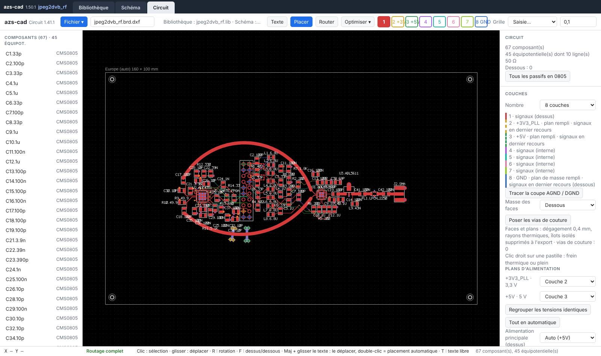

# azs-cad

Une CAO de circuits imprimés qui tourne dans un navigateur : **une seule page HTML, `azs-cad.html`**, en HTML, CSS et JavaScript natifs, sans librairie ni dépendance, utilisable hors ligne. Dans l'esprit d'Eagle 4.01 (bibliothèque, schéma, circuit), sans en être un clone. L'interface est en français ou en anglais selon le navigateur. Version actuelle : **1.50.1**.

## Modules

Un seul projet est ouvert à la fois, partagé en mémoire par les trois modules (rien n'est stocké dans le navigateur).

- **Bibliothèque** : gabarits THT et CMS courants, noms de pattes, gabarits normalisés IPC-7351 (SSOP, TSSOP, MSOP, TQFP jusqu'à 208 pattes, QFN jusqu'à 64 pattes, DFN/SON, BGA, FBGA, uBGA/CSP, WLCSP, SOT, D2PAK, quartz, CMS 0201 à 1812, tantale A à D ; `internal.lib` les charge tous), import de gabarits fabricants (`.zip` ou `.lbr`).
- **Schéma** : passifs, circuits intégrés (symbole logique), connecteurs, bus, alimentations, lignes 50 Ω, choix de la fonction des pattes multifonction. Optimiser : placement, fils à 45°, fils espacés, étiquettes d'équipotentielle à la place des fils trop longs, rangement des alimentations, **revue des découplages**.
- **Circuit** : 2 à 8 couches, plans de masse et d'alimentation, routage manuel à 45°, vias automatiques, via dans la pastille des boîtiers à billes, contrôle des espacements, sérigraphie, optimisation et routage automatique.

## Circuit

- **Empilage** : une masse unique au dessous, un plan par alimentation secondaire (tensions identiques regroupées sur une même couche), signaux partout. Panneau *Plans d'alimentation* : réseau par réseau, auto / sans plan / couche interne choisie.
- **Minimums de fabrication** PCBCart + 33 % ; seuls la largeur de piste et le perçage des vias se règlent, le Ø de cuivre en découle.
- **Router le chevelu** : routage automatique par priorité (lignes 50 Ω, signaux, alimentations, masses), en spirale horaire depuis l'IC le plus dense, passe dessus puis dessous.
- **Re-router** : un tracé n'est remplacé que s'il n'est pas plus long ; patte par patte, tronçon par tronçon, pas à pas (Espace, flèches, Échap), décision et raison affichées.
- **Optimiser** : vias, coudes à 45°, pistes qui se longent espacées, pistes centrées entre voisines, LED, résistances et condensateurs de liaison rapprochés de leurs pattes.
- **Pont d'irrigation** : un plan d'alimentation coupé en îlots est ré-alimenté par une ligne de 1 mm × 5 mm sur les couches internes de signal, quatre vias façon DIL et une sérigraphie (IRRIGATION réseau).
- **Découplages** : la *Revue* propose, par patte d'alimentation d'IC, un 100 nF et un condensateur de réservoir, et supprime les redondants (appliqué aussi au schéma). *Placer* pose chaque condensateur dans la place libre la plus proche de la patte servie, en spirale.

## RF 50 Ω

- La largeur de ligne suit l'épaisseur du substrat.
- Clic droit sur une ligne 50 Ω : longueur, **Arrondir** (un seul arc sur toute la ligne pleine largeur).
- Le routeur ne laisse passer un autre signal sous une ligne 50 Ω épaisse qu'en dernier recours : couche interne, à 90°, droit, longueur fixe, compté dans le bilan.
- Motifs de 400 à 3000 MHz : diviseur Wilkinson 2 voies, diviseur en T 2/4/8 sorties, coupleur directionnel 15/20/30 dB, filtres passe-bas et passe-bande, antenne patch rectangulaire, monopôle λ/4.

## Sorties

- Gerber RS-274X et Excellon dans une archive avec aperçu (zones non irriguées visibles). L'export est refusé tant qu'un texte de sérigraphie est sur une pastille.
- Nomenclature `.xls` et `.csv` aux colonnes de la BOM de référence.
- Projet : `<projet>.azs.zip` contenant `<projet>.lib`, `<projet>.sch.dxf` et `<projet>.brd.dxf` (DXF R12). Ctrl+S l'enregistre. Le circuit n'est jamais modifié tout seul : « Mettre à jour le circuit » est proposé quand le schéma diffère.

## Utilisation

1. Onglet Bibliothèque : créer un projet, ouvrir une bibliothèque de gabarits, cocher les composants.
2. Onglet Schéma : poser, câbler, optimiser.
3. Onglet Circuit : mettre à jour depuis le schéma, router, optimiser, exporter.

Ouvrir un projet existant : choisir son `.azs.zip` (ancien projet : `.lib` avec ses `.sch.dxf` et `.brd.dxf`).

Exemple d'optimisation du circuit sur `tvp5150_essai` : longueur des pistes de 1707 à 1156 mm, vias de 41 à 13.

## Licence

[CC BY-NC 4.0](https://creativecommons.org/licenses/by-nc/4.0/deed.fr) : usage non commercial libre avec mention de l'auteur, Eric PERRET. Tout usage commercial nécessite l'autorisation écrite de l'auteur (eperret@azs.fr).
