# azs-cad — CAO de circuits imprimés dans le navigateur

**🇫🇷 Français** · [🇬🇧 English](README.md)

Une seule page HTML, `azs-cad.html` : bibliothèque, schéma et circuit imprimé d'un même projet, en onglets. HTML/CSS/JavaScript natif, aucune dépendance, fonctionne hors ligne. Esprit Eagle 4.01, sans en être un clone. Interface en français ou en anglais selon le navigateur.

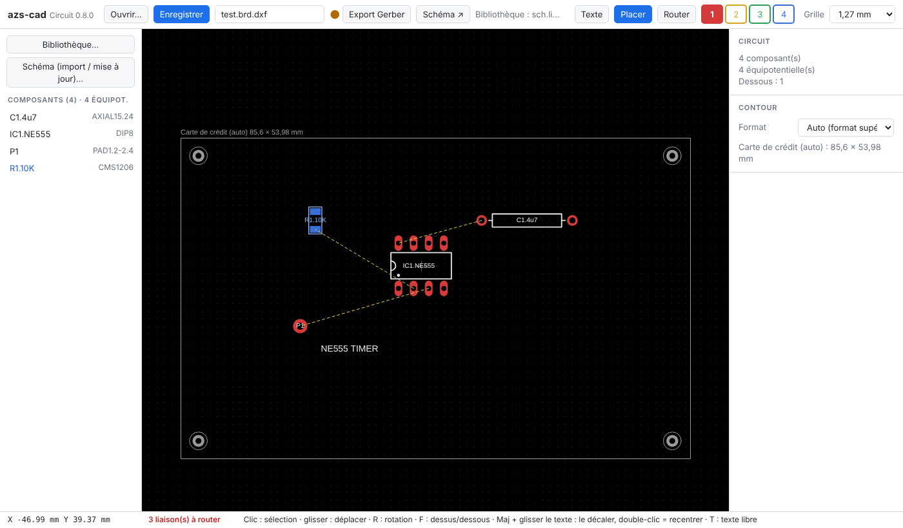

## Fonctions

- **Bibliothèque** : gabarits normalisés DIL/CMS (DIP, SOIC, QFN, TQFP, 0402–2512…), nom des pattes, import de gabarits fournisseur `.zip` / `.lbr`.
- **Schéma** : R, C, D, L, PAD, circuits du projet, bus, VCC+/GND, lignes 50 Ω, bouton **Optimiser** (voir plus bas).
- **Circuit** : 2, 4 ou 6 couches, plans GND et VCC, routage manuel 45°, vias automatiques, contrôle d'isolement, sérigraphie au vrai, bouton **Optimiser** (voir plus bas).
- **Patchs RF 50 Ω** (400 à 3000 MHz), cuivre calculé : diviseur Wilkinson, diviseur en T 2/4/8 sorties, coupleur directionnel, filtres passe-bas et passe-bande, antenne patch, monopôle λ/4.
- **Sorties** : Gerber RS-274X + Excellon en zip avec aperçu, nomenclature `.bom.xls` et `.bom.csv` (colonnes de `BOMsample.xls`).
- **Fichiers** : projet `<projet>.azs.zip` qui contient `<projet>.lib`, `<projet>.sch.dxf` et `<projet>.brd.dxf` (AutoCAD R12). Ctrl+S enregistre le projet.
- **Ouverture rapide** des projets `.azs.zip`, avec barre de progression.

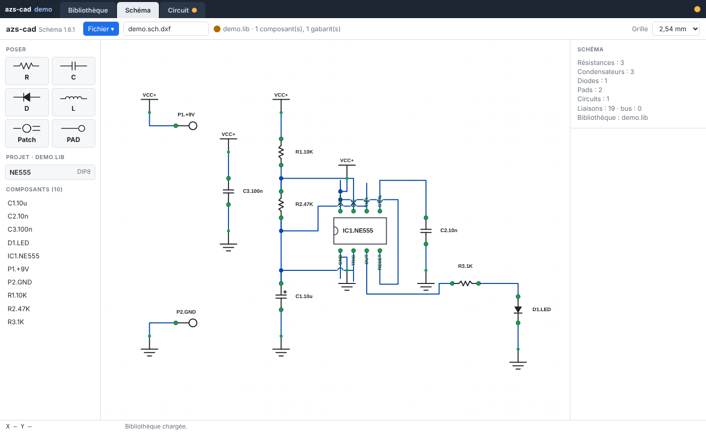

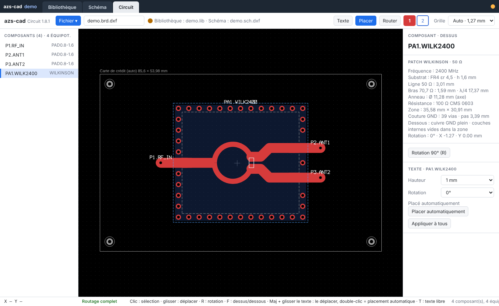

## Optimiser le schéma

Le schéma est chargé tel qu'il a été enregistré. Le bouton **Optimiser ▾** de l'onglet Schéma range l'ensemble ; Ctrl+Z revient à l'état d'avant.

- **Symboles lisibles** : circuits intégrés et connecteurs redessinés en symboles logiques (entrées à gauche, sorties à droite), sans chercher à ressembler au boîtier réel.
- **Placement automatique** de gauche à droite, passifs placés dans l'axe de leur patte, GND / VCC réduits.
- **Fils à 45°**, écartés les uns des autres, croisements à angle droit seulement.
- **Étiquettes de réseau** à la place des fils longs, noms de réseaux uniques, aucun texte sur un fil.
- **Clic** sur un fil ou une étiquette : tout le réseau (pattes et fils) s'allume. **Clic droit** : renomme le réseau.
- **Wire instead of labels** : remplace une étiquette par un fil, un par un.

| Avant | Après |
|---|---|
| 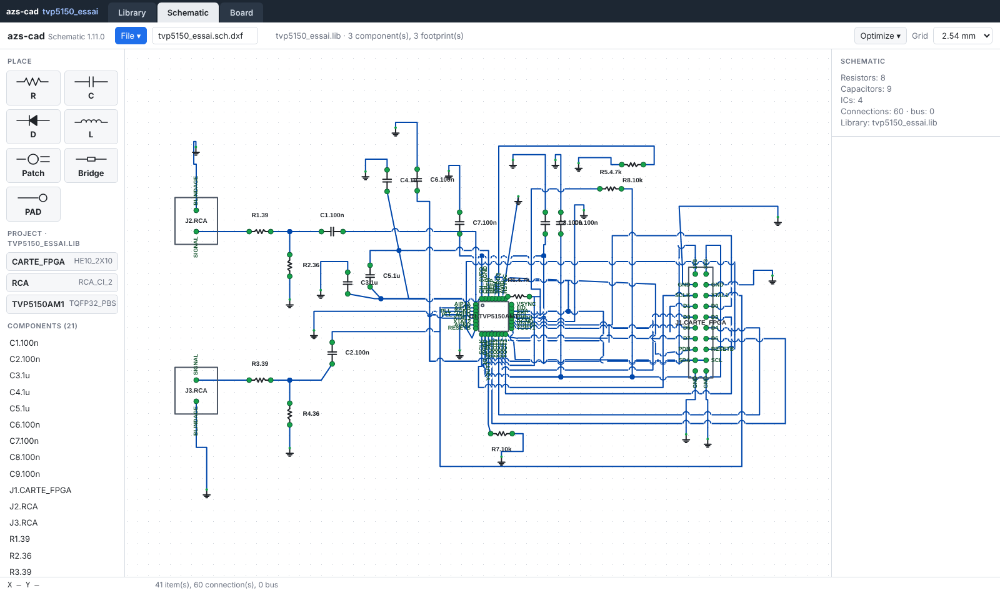 | 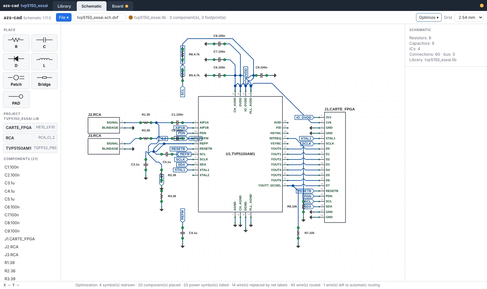 |

## Optimiser le circuit

Pour un circuit routé entièrement à la main. Menu **Optimiser ▾** de l'onglet Circuit, sur tout le circuit ou sur la piste / via sélectionnée. Ctrl+Z annule.

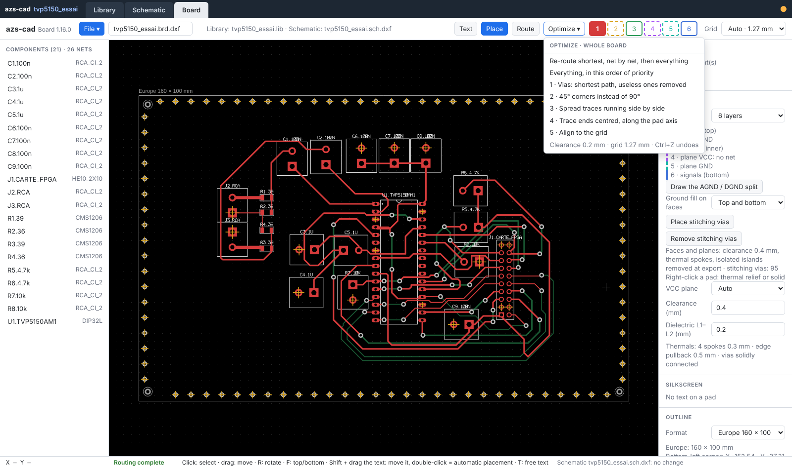

Par ordre de priorité :

1. **Vias** : déplacés au plus court dans le respect de l'isolement, vias inutiles supprimées.
2. **Coudes à 45°** au lieu de 90°.
3. **Pistes qui se longent** : écartées.
4. **Arrivées centrées** : en mode automatique la grille est alignée sur la pastille et la piste part dans son axe ; en manuel elle reste sur la grille la plus proche.
5. **Grille** : alignement sur la grille adaptée aux gabarits (par exemple 0,8 mm pour un BGA, incompatible avec 2,54 ou 1,27 mm).

**Re-router au plus court, ligne par ligne** : chaque réseau est libéré puis refait en automatique, deux passes, puis les étapes de finition. Règle : on ne passe pas une piste entre deux pattes dont l'une est un frein thermique (si le frein apparaît après le routage, la piste est refaite).

| Avant (routé à la main) | Après (re-routé) |
|---|---|
| 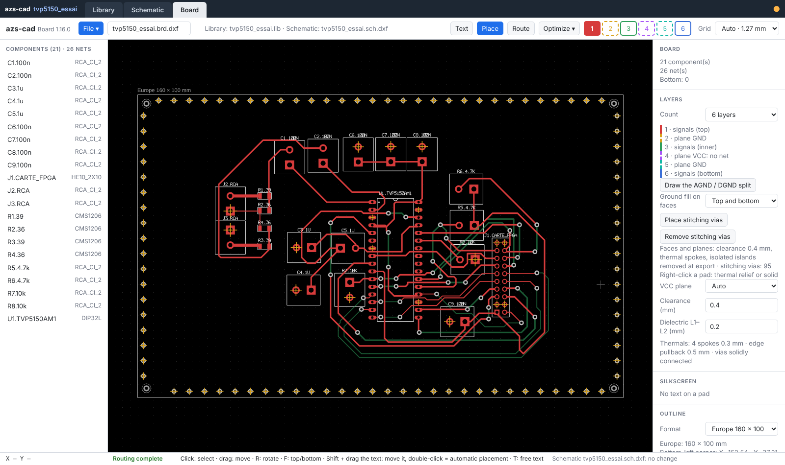 | 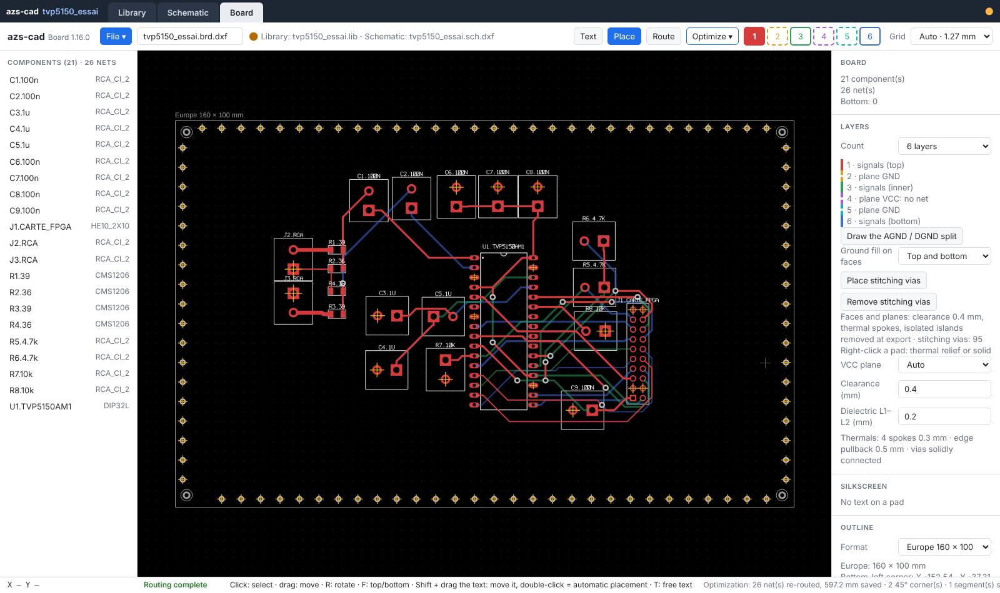 |

Sur `tvp5150_essai` : 1707 → 1156 mm de piste, 41 → 13 vias, plus aucune sortie de pastille hors axe, plus aucun îlot de cuivre dans les plans (contrôlé sur les Gerber).

## Gerber et nomenclature (format fabricant)

Sorties prêtes à envoyer à un fabricant de circuits imprimés / assembleur (« maker ») :

- **Gerber RS-274X + Excellon** en un seul zip, avec aperçu avant export : cuivre de chaque couche, plans avec frein thermique et îlots supprimés, masque, sérigraphie, perçages.
- **Nomenclature** `.bom.xls` et `.bom.csv` (séparateur `;`, UTF-8) aux colonnes de `BOMsample.xls` : Manufacturer, Manufacturer Part Number, Designator, Qty, Description, Case, SMD/BGA/LCC/TH, Top/Bottom, points, Total points, Comment. Une ligne par type + valeur + gabarit + face, repères regroupés.

Menu Fichier de l'onglet Circuit :

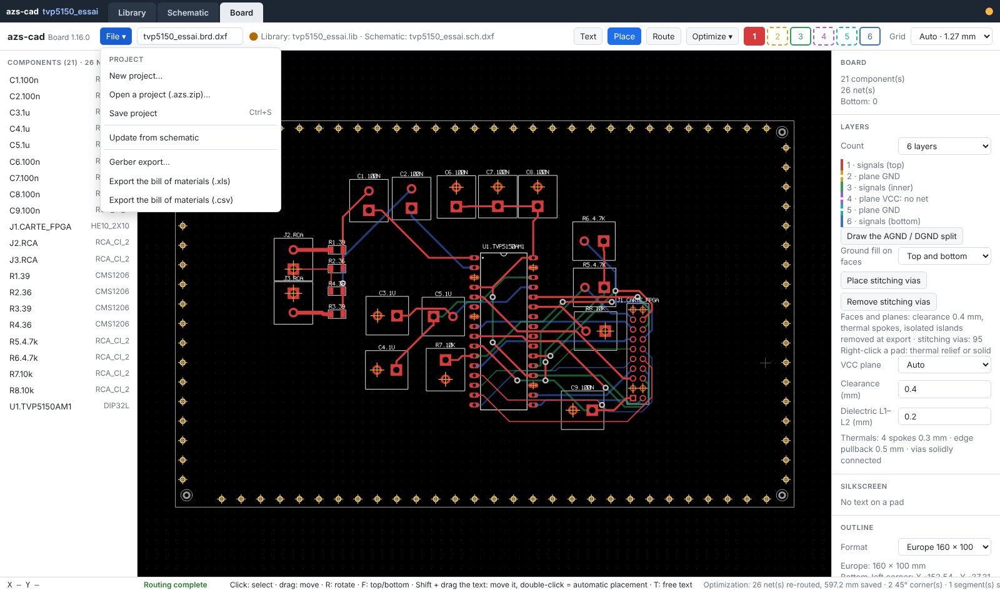

Aperçu Gerber avant téléchargement : une miniature par fichier produit (cuivre des 6 couches, vernis, sérigraphie…), puis vue détaillée d'une couche, avec cases à cocher pour superposer les couches.

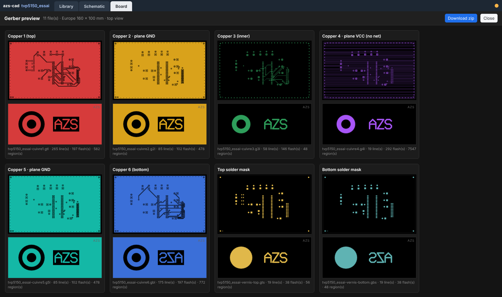

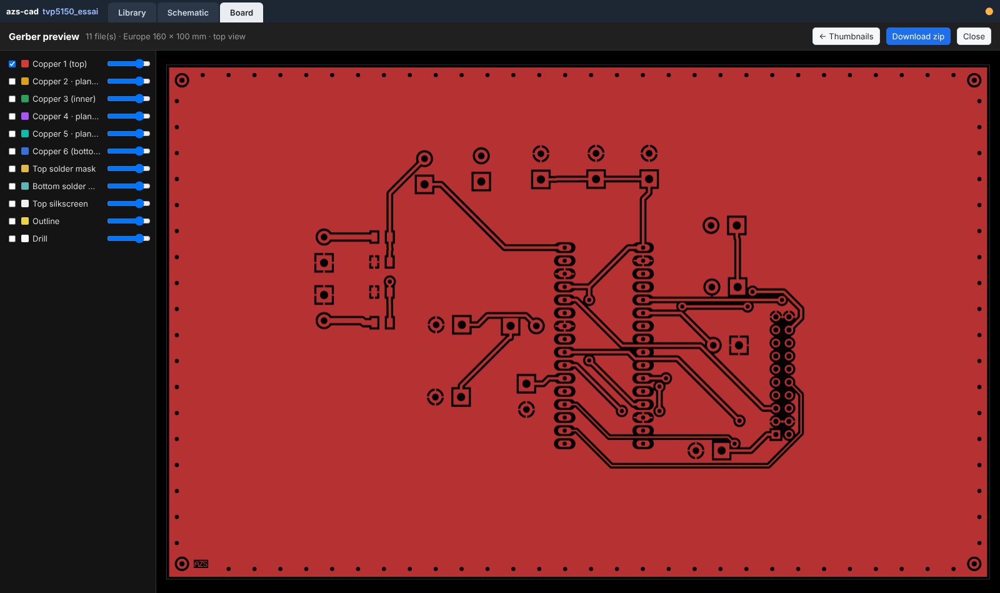

Nomenclature `.bom.csv` produite pour `tvp5150_essai` :

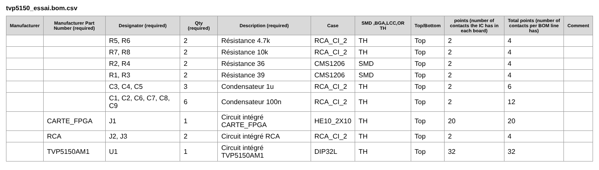

## Licence

[CC BY-NC 4.0](https://creativecommons.org/licenses/by-nc/4.0/deed.fr) : usage non commercial libre, avec mention « azs-cad — Eric PERRET — https://github.com/ericperret/pcb-cad ». Usage commercial sur autorisation écrite : eperret@azs.fr. Voir `LICENSE`.

© Eric PERRET 2026 · eperret@azs.fr · www.azs.fr
