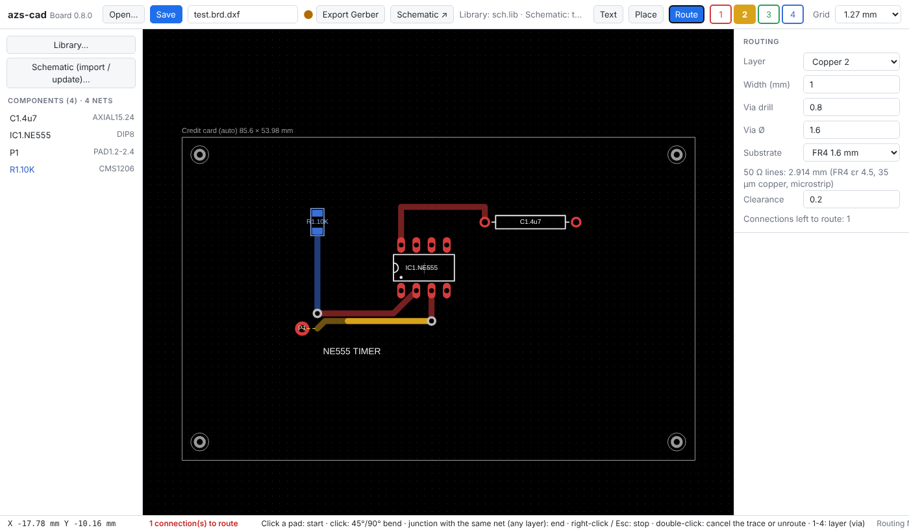
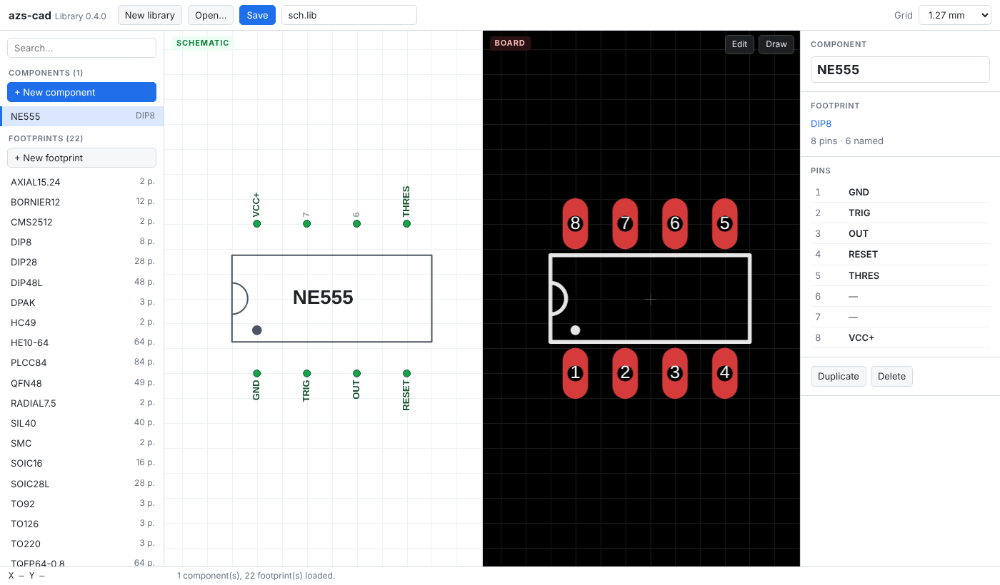
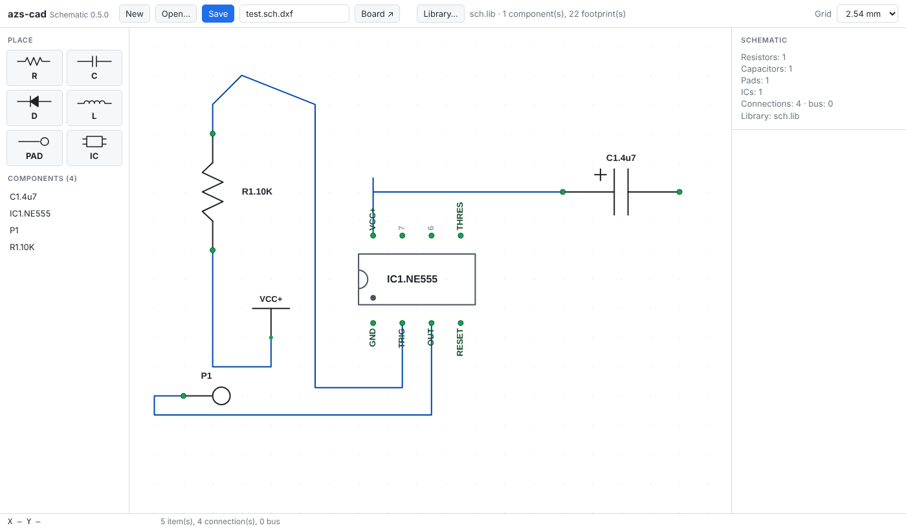
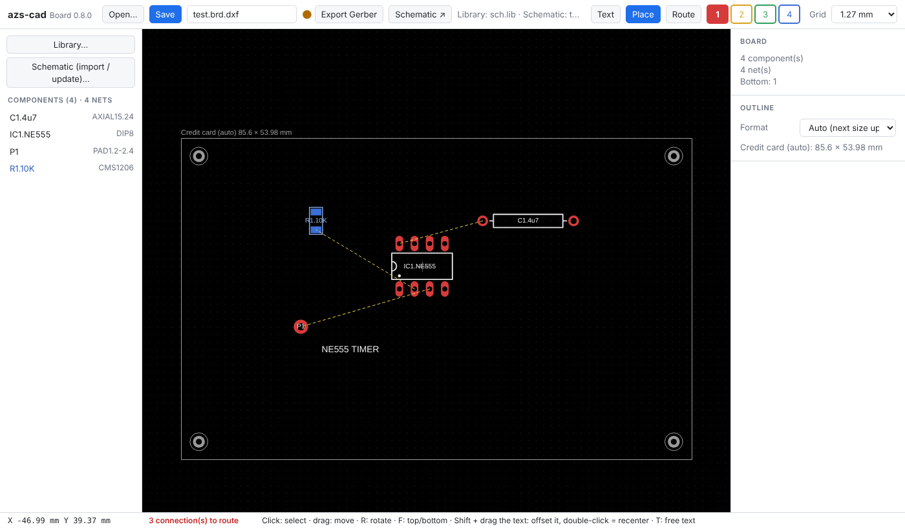
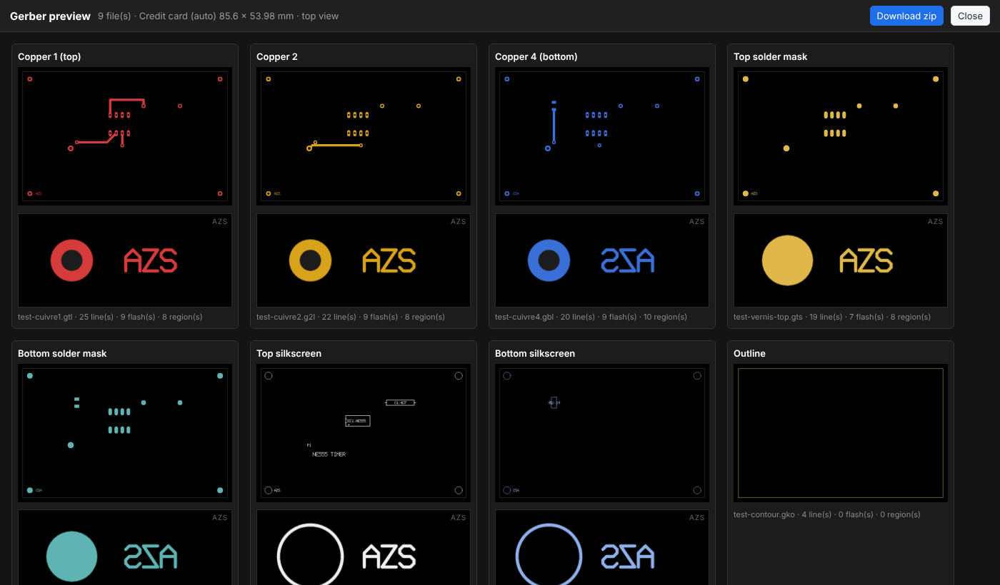
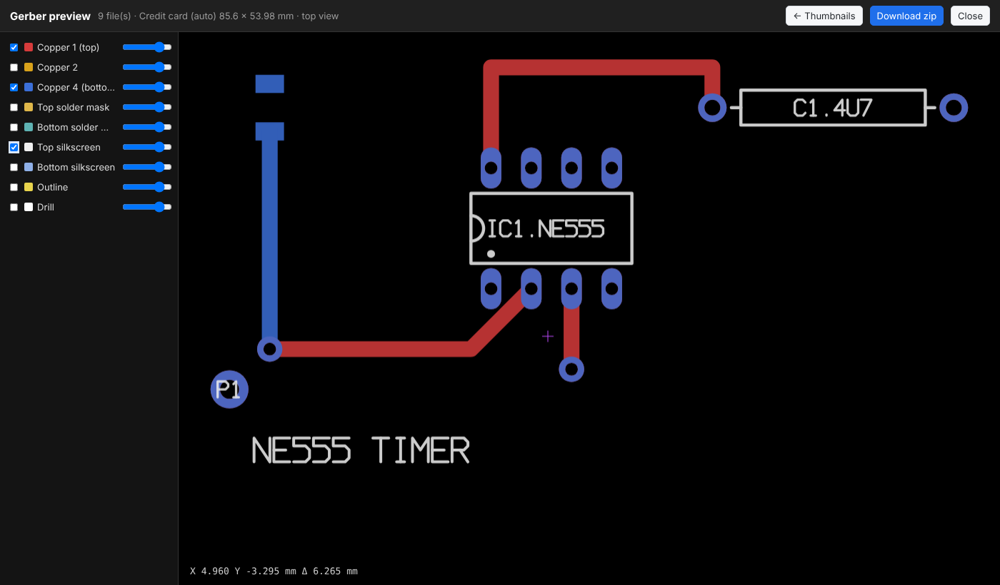

# azs-cad — PCB design in the browser

[🇫🇷 Français](LISEZMOI.md) · **🇬🇧 English**

Component library, schematic capture and multilayer PCB, in three standalone HTML pages: plain HTML/CSS/JavaScript, no dependency, works offline. In the spirit of Eagle 4.01 without cloning it: manual routing, 4 copper layers, Gerber RS-274X and Excellon export.

The interface is in French when the browser is set to French, in English otherwise.



## Files

| File | Version | Role |
|---|---|---|
| `bibliotheque.html` | 0.4.0 | Library: components, footprints, pin names |
| `schema.html` | 0.5.0 | Schematic capture |
| `board.html` | 0.8.0 | Board: placement, routing, export |
| `README.md`, `LISEZMOI.md` | | Documentation in English, in French |
| `LICENSE` | | CC BY-NC 4.0 |

The three pages must sit in the **same folder** and be opened in the **same browser** (Chrome or Edge recommended).

## Getting started

1. Open `bibliotheque.html`, create or open a `.lib` library, save it.
2. Open `schema.html`, load the library, draw the schematic.
3. **Board ↗** button: `board.html` opens on the same project and follows the schematic live, with no saving or reloading.
4. Place, route, pick the outline, then **Export Gerber**: preview, then download a zip.

## Library — `bibliotheque.html`



- Two views: **SCHEMATIC** (white background, green pins) and **BOARD** (black background, red copper), shared zoom and pan.
- **+ New component**: standard family and pin count, then name (e.g. `NE555`). Families: DIP narrow/wide, SIL, HE10, screw terminal, axial, radial, TO-92/126/220, HC-49, SOIC, TSSOP, PLCC, TQFP, QFN, SMD 0402 to 2512, SMD diodes, SOT, DPAK.
- Pin names: click the pin (Tab = next pin), right-click = list (VCC+, GND…), or the Pin | Name table.
- **Edit**: selection, handles, move, rotate (R), delete (Del), THT/SMD type changed in place. **Draw**: THT/SMD pads, line, rectangle, arc, circle, dot, text.
- Solder mask is not drawn: it derives from the pads.

`.lib` format (plain text, mm, degrees, one statement per line, `#` = comment; keywords stay in French):

```
PACKAGE DIP8
PAD 1 -3.81 -3.81 0.8 1.3 OVALE 90      # name x y drill diameter ROND|CARRE|OVALE rotation
SMD 1 -0.95 0 0.6 1.0 0                  # name x y dx dy rotation
TRAIT x1 y1 x2 y2 width                  # line
RECT x1 y1 x2 y2 width
ARC cx cy r angle1 angle2 width          # counter-clockwise
CERCLE cx cy r width                     # circle
POINT x y r
FIN                                      # end
COMPOSANT NE555 DIP8 SOIC8               # component name, then allowed footprints
GND => 1                                 # function => pins
VCC+ => 8
FIN
```

## Schematic — `schema.html`



- Palette: **R** (zigzag), **C** (two plates, polarized "+" above 1 µF, can be forced), **D** (pin 1 = cathode), **L**, **PAD** (one pin), **IC** (drawn as in the library). Automatic references R1, C1, D1, L1, P1, IC1; labels `IC1.NE555`, `R1.10K`.
- Click in empty space: places the last component again, same value.
- Connection: click pin → pin. Right-click a pin: **VCC+** or **GND**.
- Groups: Ctrl+click / Shift+click on pins; two groups of the same size make a **bus** (combs and a thick trunk labeled with the count), paired by pin number.
- Selected wire: square = move a bend, middle circle = new bend, double-click = delete. Type **Electrical** or **50 Ω line** (dashed orange). Automatic orthogonal path.
- Crossing of two different nets: hop; same net: junction dot.
- R: rotate · Del: delete · Ctrl+Z / Ctrl+Y · Ctrl+S.

## Board — `board.html`



### Placement
- Schematic import, or the **Schematic ↗ / Board ↗** link: components pre-placed as in the schematic, spread just enough not to overlap.
- Footprint picked in the side panel: library footprints first, then generated **standard** ones (same families as the library, single THT or SMD pad). Passives reuse the last footprint chosen for their type.
- R: rotate · F: top / bottom (bottom shown in blue, seen from the top).
- The `IC1.NE555` label is glued to the component; Shift + drag offsets it, double-click recenters it.
- **Text** (T): free silkscreen text, height in mm, side of your choice.
- A component that is moved, rotated, flipped or given another footprint loses its copper: its connections go back to the ratsnest.

### Routing
- **Route**, then click a pad: the trace starts on the component's side layer (copper 1 top, copper 4 bottom).
- Each click lays a straight then 45° bend. Keys **1 to 4** or the colored buttons: layer change, via placed automatically.
- End: click a pad, track or via of the same net, on any layer (via added when needed). Right-click or Esc: stop and keep the segments. **Double-click: cancels the current trace.**
- Outside a trace: double-click a track or via = unroute, back to the dashed yellow ratsnest.
- Click a segment: select; drag = move; Del = delete; click the free end of a selected segment = extend. Right-click a track: standard width (0.2 to 2.54 mm) or typed value.
- The dashed yellow ratsnest follows the trace; 50 Ω lines are orange.
- Clearance: passing too close to copper of another net is circled in purple with the measured distance; placement is never refused.
- Permanent counter of connections left to route in the status bar.

### Manufacturing settings

| Setting | Default | Minimum (PCBCart standard × 2) |
|---|---|---|
| Track width | 1 mm, then the last one used | 0.152 mm |
| Clearance | 0.2 mm | 0.152 mm |
| Via (drill / Ø) | 0.8 / 1.6 mm | drill 0.304 mm, annular ring 0.152 mm |
| Substrate | FR4 1.6 mm (or 0.8), εr 4.5, 35 µm copper | |

50 Ω width (microstrip, IPC-2141): `w = (5.98·h / exp(50·√(εr+1.41) / 87) − t) / 0.8`, i.e. 2.914 mm on 1.6 mm.

### Outline and export



- Outline: **Auto** (credit card 85.6 × 54, else Europe 160 × 100, else the next size up), a forced format or **Custom**; 5 mm margin, centered on the project.
- 4 alignment marks 3 mm from the corners (copper Ø 2, mask Ø 2.4, silkscreen Ø 3, hole Ø 1) and "**AZS**" on every layer to check orientation: readable on top layers, mirrored on bottom layers.
- **Export Gerber**: preview read back from the generated files — top-view thumbnails, "AZS" magnifier, enlarged view with stackable layers, transparency, coordinates and measurement (Shift + click) — then **Download zip** `<name>-gerber.zip`.



| File | Content |
|---|---|
| `-cuivre1.gtl` | Copper 1 (top) |
| `-cuivre2.g2l`, `-cuivre3.g3l` | Inner copper, when it carries a track |
| `-cuivre4.gbl` | Copper 4 (bottom) |
| `-vernis-dessus.gts`, `-vernis-dessous.gbs` | Solder mask openings (0.1 mm margin) |
| `-serigraphie-dessus.gto`, `-serigraphie-dessous.gbo` | Silkscreen (stroke font, upper case) |
| `-contour.gko` | Outline |
| `-percage.drl` | Excellon drill (mm) |

## Schematic ↔ board link

Each page publishes its state to the browser's local storage on every change; the other page follows with no action. Unchanged parts stay placed and routed; an added component appears to the right of the board; a deleted component leaves with its copper; a modified connection drops the tracks of its net. **Save** writes the files to disk.

## Shortcuts

| Key | Library | Schematic | Board |
|---|---|---|---|
| R | rotate | rotate | rotate |
| F | | | top / bottom |
| T | | | free text |
| 1 to 4 | | | copper layer (via while routing) |
| Del | delete | delete | segment, via or text |
| Esc | end action | cancel placement / connection | stop the trace, deselect |
| Ctrl+Z / Ctrl+Y | undo / redo | undo / redo | undo / redo |
| Ctrl+S | save | save | save |

## Formats

- Schematic `.sch.dxf` and board `.brd.dxf`: multilayer **AutoCAD R12 (AC1009)**, readable by any CAD software; azs-cad data in XDATA (APPID `AZSCAD`; `AIGLECAD` files from early versions are still read).
- Board layers: `CUIVRE_1` to `CUIVRE_4` (copper), `VERNIS_DESSUS`, `VERNIS_DESSOUS` (solder mask), `TEXTE_DESSUS`, `TEXTE_DESSOUS` (silkscreen), `PERCAGE` (drill), `CHEVELU` (ratsnest), `AZSCAD`.
- Library `.lib`: plain text (see above).

## Limitations

No autorouter, no ground planes, through-hole vias only, no restrict/keepout layer. The schematic ↔ board link needs the same browser.

## License

Free for non-commercial use under the [CC BY-NC 4.0](https://creativecommons.org/licenses/by-nc/4.0/deed.en) license, with mandatory credit to the source and author: "azs-cad — Eric PERRET — https://github.com/ericperret/azs-cad". Any commercial use is forbidden without the author's written permission, requested by e-mail: eperret@azs.fr. See `LICENSE`.

## Author

© Eric PERRET 2026 · eperret@azs.fr · www.azs.fr
