# azs-cad — PCB design in the browser

[🇫🇷 Français](LISEZMOI.md) · **🇬🇧 English**

A single HTML page, `azs-cad.html`: library, schematic and board of one project, in tabs. Plain HTML/CSS/JavaScript, no dependency, works offline. In the spirit of Eagle 4.01 without cloning it. The interface is in French or English depending on the browser.

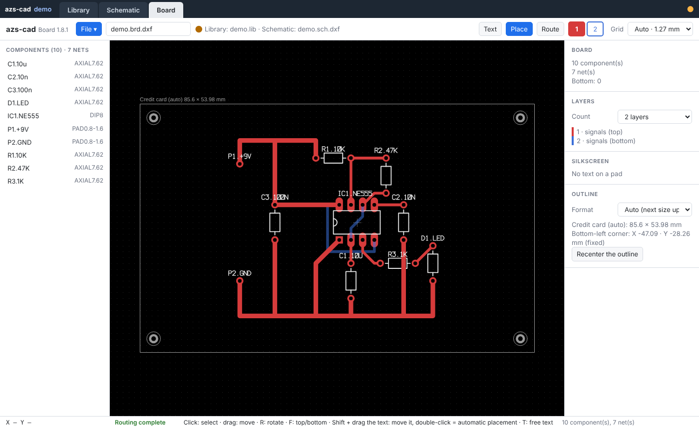

## Features

- **Library**: standard THT/SMD footprints (DIP, SOIC, QFN, TQFP, 0402–2512…), pin names, vendor footprint import (`.zip` / `.lbr`).
- **Schematic**: R, C, D, L, PAD, project ICs, buses, VCC+/GND, 50 Ω lines, **Optimize** button (see below).
- **Board**: 2, 4 or 6 layers, GND and VCC planes, manual 45° routing, automatic vias, clearance check, true-size silkscreen, **Optimize** button (see below).
- **50 Ω RF patches** (400 to 3000 MHz), computed copper: Wilkinson splitter, T splitter with 2/4/8 outputs, directional coupler, low-pass and band-pass filters, patch antenna, λ/4 monopole.
- **Outputs**: Gerber RS-274X + Excellon as a zip with preview, bill of materials as `.bom.xls` and `.bom.csv` (columns of `BOMsample.xls`).
- **Files**: project `<project>.azs.zip` containing `<project>.lib`, `<project>.sch.dxf` and `<project>.brd.dxf` (AutoCAD R12). Ctrl+S saves the project.
- **Fast opening** of `.azs.zip` projects, with a progress bar.

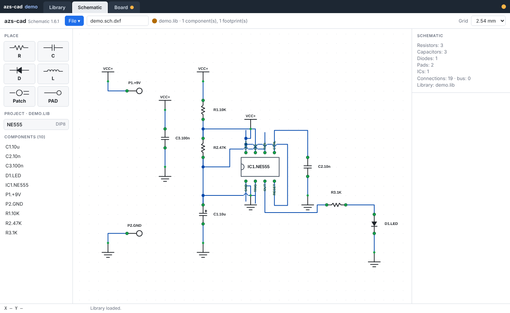

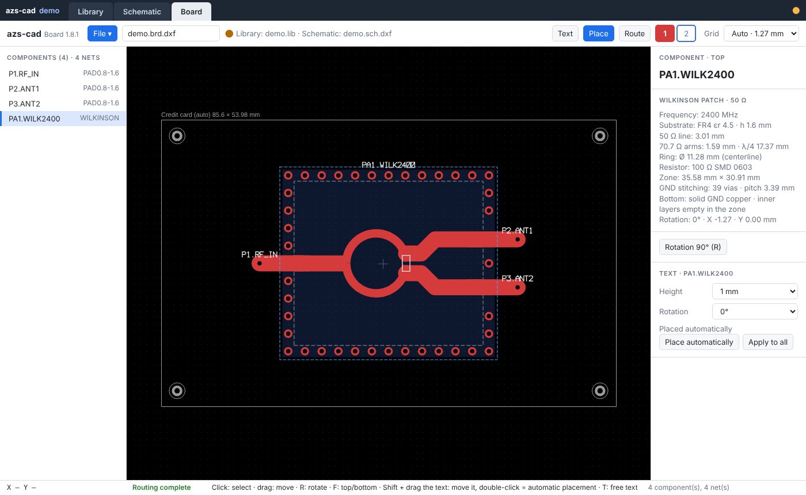

## Optimizing the schematic

The schematic loads as it was saved. The **Optimize ▾** button of the Schematic tab tidies everything; Ctrl+Z goes back.

- **Readable symbols**: ICs and connectors redrawn as logical symbols (inputs left, outputs right), not trying to look like the real package.
- **Automatic placement** from left to right, passives placed in the axis of their pin, GND / VCC reduced.
- **45° wires**, kept apart, crossings at right angles only.
- **Net labels** instead of long wires, unique net names, no text on a wire.
- **Click** a wire or a label: the whole net (pins and wires) lights up. **Right-click**: renames the net.
- **Wire instead of labels**: replaces a label by a wire, one at a time.

| Before | After |
|---|---|
| 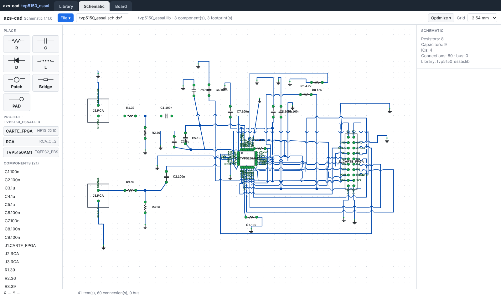 | 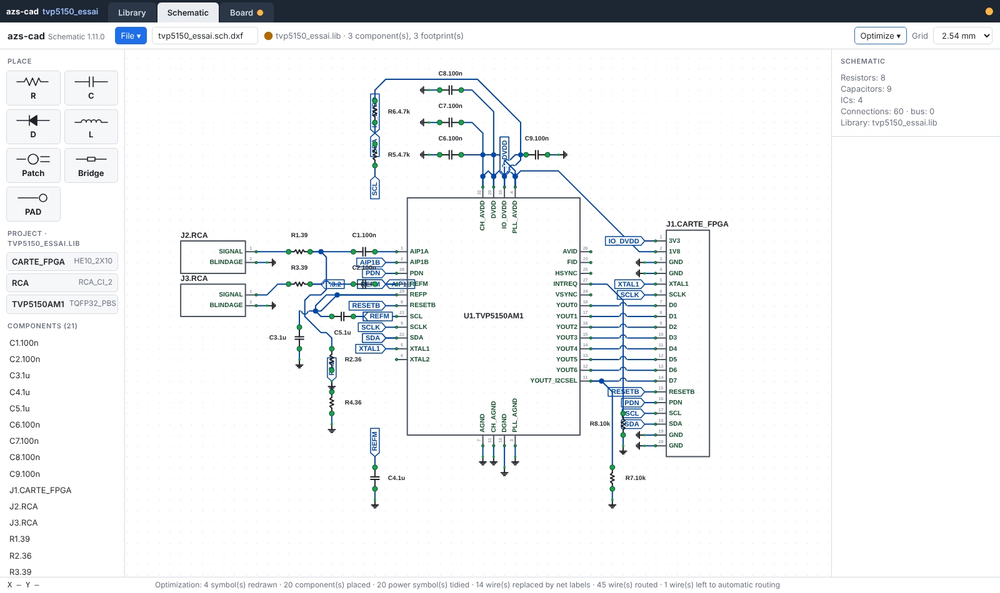 |

## Optimizing the board

For a board routed entirely by hand. **Optimize ▾** menu of the Board tab, on the whole board or on the selected trace / via. Ctrl+Z undoes.

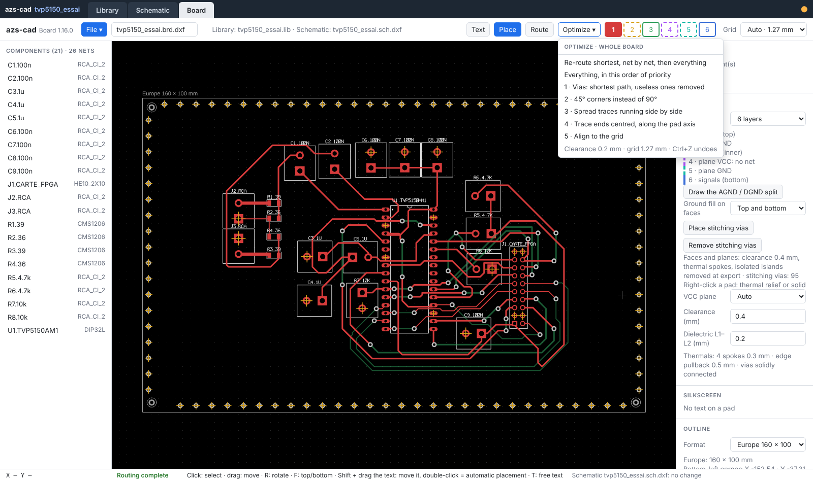

In order of priority:

1. **Vias**: moved to the shortest path while keeping clearance, useless ones removed.
2. **45° corners** instead of 90°.
3. **Traces running side by side**: spread apart.
4. **Centred ends**: in automatic mode the grid is aligned on the pad and the trace leaves along its axis; in manual mode it stays on the nearest grid.
5. **Grid**: alignment on the grid suited to the footprints (for example 0.8 mm for a BGA, incompatible with 2.54 or 1.27 mm).

**Re-route at shortest, line by line**: each net is released then redone automatically, two passes, then the finishing steps. Rule: no trace between two pins when at least one is a thermal relief (if the relief appears after routing, the trace is redone).

| Before (hand-routed) | After (re-routed) |
|---|---|
| 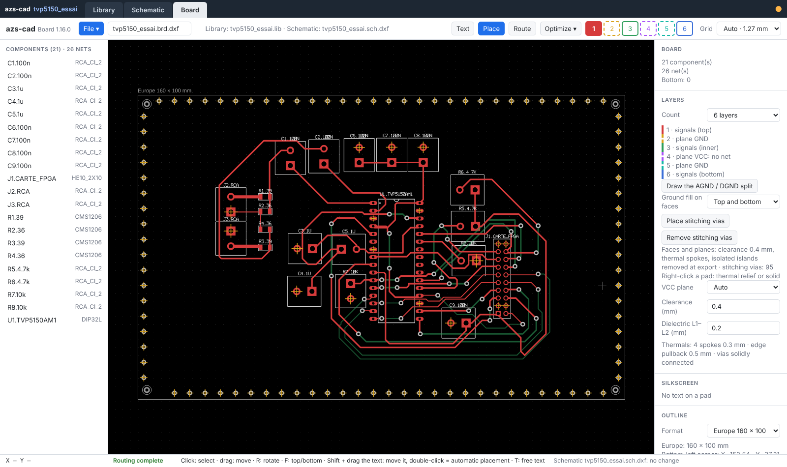 | 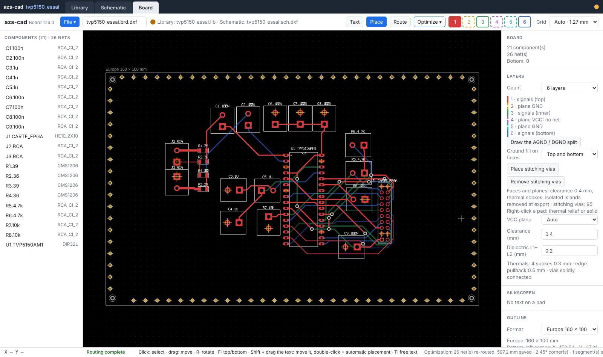 |

On `tvp5150_essai`: 1707 → 1156 mm of trace, 41 → 13 vias, no pad exit off-axis left, no copper island left in the planes (checked on the Gerbers).

## Gerber and bill of materials (maker format)

Outputs ready to send to a PCB manufacturer / assembler (a "maker"):

- **Gerber RS-274X + Excellon** in a single zip, with a preview before export: copper of each layer, planes with thermal reliefs and islands removed, solder mask, silkscreen, drills.
- **Bill of materials** `.bom.xls` and `.bom.csv` (`;` separator, UTF-8) with the columns of `BOMsample.xls`: Manufacturer, Manufacturer Part Number, Designator, Qty, Description, Case, SMD/BGA/LCC/TH, Top/Bottom, points, Total points, Comment. One line per type + value + footprint + side, designators grouped.

File menu of the Board tab:

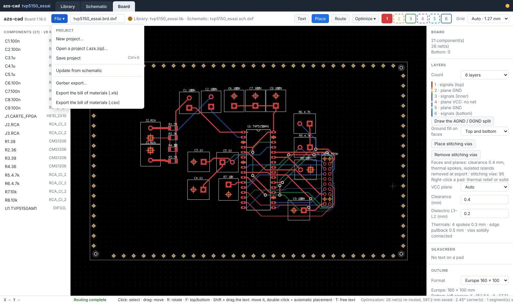

Gerber preview before download: one thumbnail per produced file (copper of the 6 layers, solder mask, silkscreen…), then a detailed view of one layer, with check boxes to overlay layers.

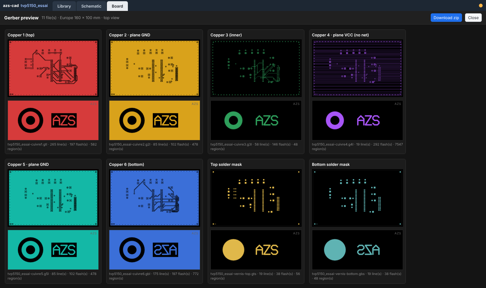

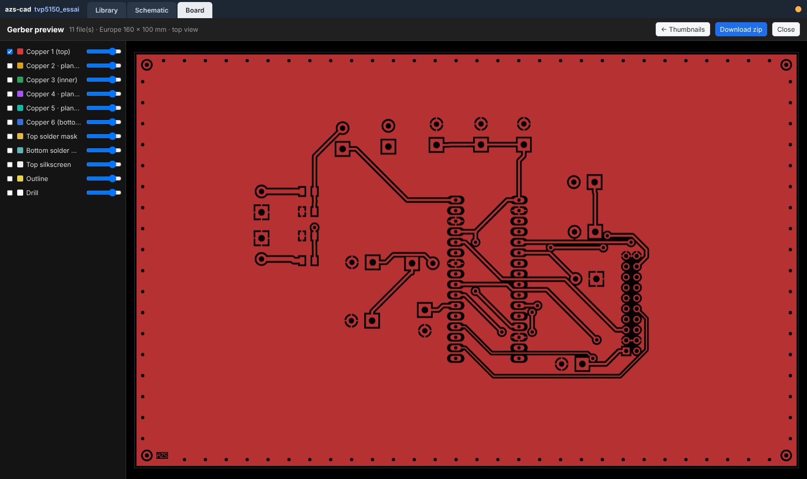

`.bom.csv` produced for `tvp5150_essai`:

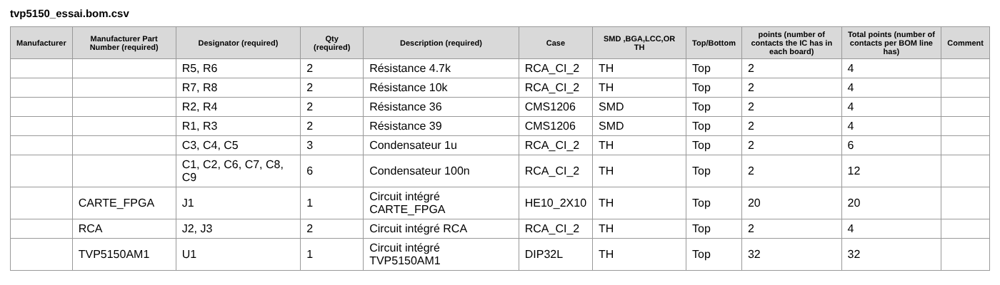

## License

[CC BY-NC 4.0](https://creativecommons.org/licenses/by-nc/4.0/deed.en): free for non-commercial use, with credit "azs-cad — Eric PERRET — https://github.com/ericperret/pcb-cad". Commercial use requires written permission: eperret@azs.fr. See `LICENSE`.

© Eric PERRET 2026 · eperret@azs.fr · www.azs.fr
