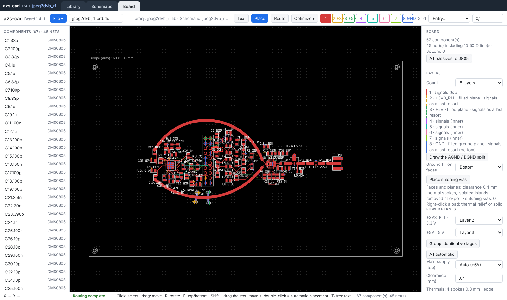
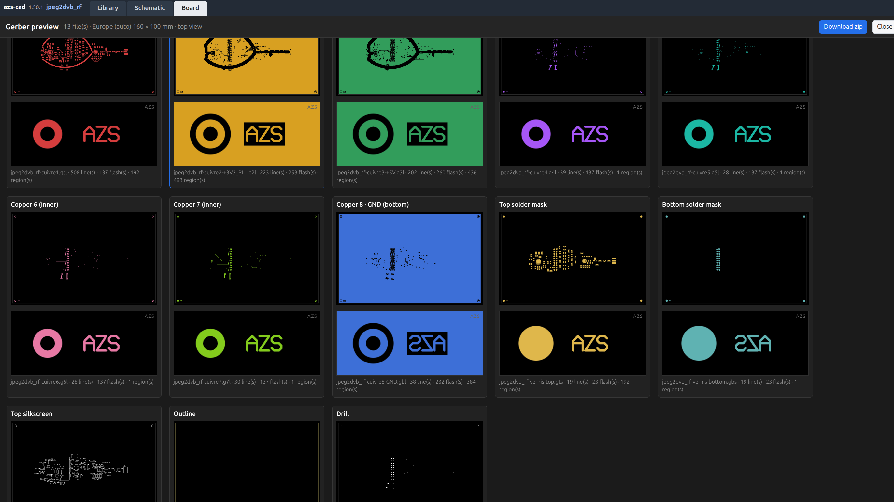

# azs-cad

A printed circuit board CAD that runs in a web browser: **one HTML page, `azs-cad.html`**, plain HTML, CSS and JavaScript, no library, no dependency, works offline. Inspired by the spirit of Eagle 4.01 (library, schematic, board), not a clone. The interface is French or English depending on the browser. Current version: **1.50.1**.

## Modules

One project is open at a time and shared in memory by the three modules (nothing is stored in the browser).

- **Library**: common THT and SMD footprints, pin names, standard footprints after IPC-7351 (SSOP, TSSOP, MSOP, TQFP up to 208 pins, QFN up to 64 pins, DFN/SON, BGA, FBGA, uBGA/CSP, WLCSP, SOT, D2PAK, crystals, SMD 0201 to 1812, tantalum A to D; `internal.lib` loads them all), import of manufacturer footprints (`.zip` or `.lbr`).
- **Schematic**: passives, integrated circuits (logic symbol), connectors, buses, supplies, 50 ohm lines, multifunction pin choice. Optimize: placement, 45 degree wires, spaced wires, net labels instead of overlong wires, supply ranking, **decoupling review**.
- **Board**: 2 to 8 layers, ground and supply planes, manual routing at 45 degrees, automatic vias, via in pad for ball grid packages, clearance checks, silkscreen, optimization and automatic routing.

## Board

- **Stack-up**: one ground plane below, one plane per secondary supply (same voltages grouped on one layer), signals everywhere. Panel *Supply planes*: per net, auto / no plane / chosen inner layer.
- **Fabrication minimums** from PCBCart + 33 %; only track width and via drill are set, the copper diameter follows.
- **Route the ratsnest**: automatic routing by priority (50 ohm lines, signals, supplies, grounds), clockwise spiral from the densest IC, top then bottom pass.
- **Re-route**: shortest path kept only if not longer; pin by pin, segment by segment, step by step (Space, arrows, Esc) with the decision and its reason displayed.
- **Optimize**: vias, 45 degree corners, parallel tracks spaced, tracks centered between neighbours, LEDs / resistors / coupling capacitors moved close to their pins.
- **Irrigation bridge**: a supply plane cut in two islands is fed again by a 1 mm x 5 mm line on the inner signal layers with four DIL-like vias and a silkscreen text (IRRIGATION net).
- **Decoupling**: *Review* proposes, per IC supply pin, one 100 nF and one bulk capacitor, and deletes the redundant ones (applied to the schematic too). *Place* puts each capacitor in the nearest free spot around the pin it serves, in a spiral.

## 50 ohm RF

- Line width follows the substrate thickness.
- Right click on a 50 ohm line: length, **Round** (one single arc over the whole full-width line).
- The router lets other signals cross under a thick 50 ohm line only as a last resort: inner layer, at 90 degrees, straight, fixed length, counted in the report.
- Patterns from 400 to 3000 MHz: Wilkinson 2-way divider, T divider 2/4/8 outputs, directional coupler 15/20/30 dB, low-pass and band-pass filters, rectangular patch antenna, quarter-wave monopole.

## Outputs

- Gerber RS-274X and Excellon in a zip with preview (unfed zones shown). The export is refused while a silkscreen text lies on a pad.
- Bill of materials `.xls` and `.csv` with the columns of the sample BOM.
- Project: `<project>.azs.zip` containing `<project>.lib`, `<project>.sch.dxf` and `<project>.brd.dxf` (DXF R12). Ctrl+S saves it. The board is never changed by itself: *Update the board* is offered when the schematic differs.

## Use

1. Library tab: create a project, open a footprint library, tick the components.
2. Schematic tab: place, wire, optimize.
3. Board tab: update from the schematic, route, optimize, export.

Open an existing project by choosing its `.azs.zip` (an old project: `.lib` with its `.sch.dxf` and `.brd.dxf`).

Example of board optimization on `tvp5150_essai`: track length from 1707 to 1156 mm, vias from 41 to 13.

## License

[CC BY-NC 4.0](https://creativecommons.org/licenses/by-nc/4.0/): free non commercial use with attribution to Eric PERRET. Any commercial use requires the written authorization of the author (eperret@azs.fr).
